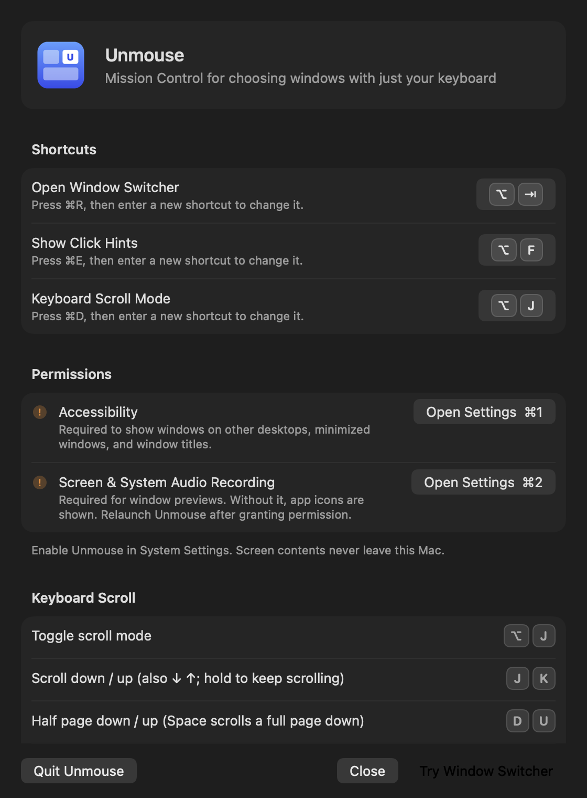

# Unmouse

A macOS menu bar app that lets you use your Mac with the keyboard alone.
Switching windows, clicking, scrolling — the three moments your hand used to reach for the mouse each become a single shortcut.

| Feature | Default shortcut | What it does |
| --- | --- | --- |
| Window switcher | `⌥Tab` | Lays out every open window on one screen and jumps to one with a single letter |
| Click hints | `⌥F` | Labels buttons, links, and text fields with letters; type the letters to click |
| Keyboard scroll | `⌥J` | Scrolls the area you are looking at with `J` `K` `D` `U` |

All three shortcuts can be changed in Settings.

> **Note:** The screenshots below show the Korean interface.


## Window switcher — `⌥Tab`

Shows the windows from all of your desktops as previews. Press the letter on a preview to jump straight to that window.

In the screenshot above, pressing `S` jumps to Terminal, and `F` jumps to Calendar on another desktop. Minimized windows are shown too.

Press `/` and type to filter by app name or window title.


| Key | Action |
| --- | --- |
| `⌥Tab` | Open · while open, move to the next window |
| `A` … `Z` | Jump to the window with that letter on its preview |
| `←` `↑` `↓` `→` | Move the selection (`Tab` / `⇧Tab` also work) |
| `Space` | Go to the selected window (`↩` also works) |
| `/` | Search by app name or window title (press `↩` to select while searching) |
| `⌘,` | Open Settings |
| `esc` | Close |

## Click hints — `⌥F`

Labels every button, link, and text field in the window you are using with letters. Type those letters to click that spot.


In the screenshot above, pressing `Y` clicks the blue "Try it now" button, and `T` clicks the "Keyboard scroll" item in the sidebar.

| Key | Action |
| --- | --- |
| `⌥F` | Show hints |
| `A` … `Z` | Type the letters shown to click that spot |
| `⇧` + last letter | Right-click |
| `⌘` + last letter | `⌘`-click (open in a new tab, etc.) |
| `⌫` | Delete one letter |
| `esc` | Cancel |

In some apps, such as Chrome, fewer web page elements may be labeled the first time. If that happens, press the shortcut once more.

## Keyboard scroll — `⌥J`

Turning on scroll mode moves the pointer to the center of the scrollable area, and the keys below scroll it.


The outline marks the area being scrolled. Press `Tab` to move over to the sidebar.

| Key | Action |
| --- | --- |
| `⌥J` | Turn scroll mode on / off |
| `J` `K` | Scroll down / up (`↓` `↑` also work; hold to keep scrolling) |
| `D` `U` | Half a page down / up (`Space` scrolls one page down) |
| `G` `G` | Jump to the top |
| `⇧G` | Jump to the bottom |
| `H` `L` | Scroll left / right |
| `Tab` | Switch the area being scrolled (sidebar ↔ content, etc.) |
| `esc` | Exit |

## Settings



Open the settings window from **Settings…** (**설정…** in Korean) in the menu bar icon's menu, or by launching Unmouse again from Spotlight while it is already running. You don't need the mouse inside the settings window either.

- Press `⌘R` / `⌘E` / `⌘D`, then type a new shortcut to change the window switcher / click hints / keyboard scroll shortcut.
- `⌘1` / `⌘2` open the System Settings pane for each permission.
- You can toggle launch at login, including windows from other desktops, and including minimized or hidden windows.

## Permissions

On first launch, the settings window opens and walks you through two permissions.

| Permission | Used for | Without it |
| --- | --- | --- |
| Accessibility | Click hints, keyboard scroll, windows on other desktops, minimized windows, and window titles | Click hints and scrolling are unavailable, and the switcher shows only the windows on the current screen |
| Screen & System Audio Recording | Window preview images | App icons are shown instead of previews |

After you grant the screen recording permission, relaunch Unmouse for it to take effect. Screen contents never leave your Mac.

## Installation

Requires macOS 26 or later and a Swift 6 toolchain (Xcode 26).

```sh
git clone https://github.com/olennis/unmouse.git
cd unmouse
scripts/build-app.sh --install --run
```

- With no arguments, the script only builds `build/Unmouse.app`.
- `--install` copies it to `/Applications/Unmouse.app`, and `--run` launches the built app.
- If you have a code signing certificate (Apple Development or Developer ID), the app is signed with it and keeps its permissions across rebuilds. Without one it is ad-hoc signed, so you have to grant the permissions again after every build. Set the `CODESIGN_IDENTITY` environment variable to choose a certificate.

## Good to know

- Unmouse uses a private framework (SkyLight) to bring windows on other desktops to the front. Its behavior may change with macOS updates, and the app cannot be distributed on the Mac App Store.
- Only one of the window switcher, click hints, and keyboard scroll can be active at a time.

## Regenerating the screenshots

The screenshots in this document are not real screen captures: they are the app's actual UI rendered on top of mock windows. You can regenerate them without granting any permissions.

```sh
swift build -c release
.build/release/Unmouse --demo docs/images     # switcher, search, click hints, scroll
```

## Interface language

The app follows your Mac’s preferred language and supports English and Korean. Other languages fall back to English. You can also choose a language for this app in **System Settings → General → Language & Region → Applications**. Relaunch the app after changing its language.

To verify the localization resources and language selection after a release build:

```sh
python3 scripts/check-localization.py
```

See [CHANGELOG.md](CHANGELOG.md) for changes.
