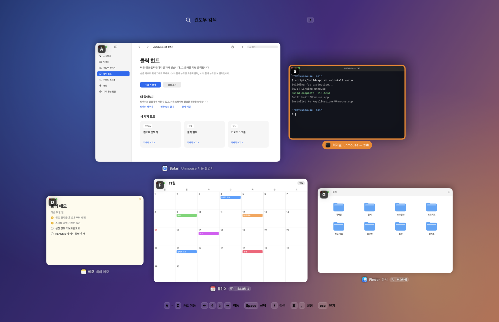
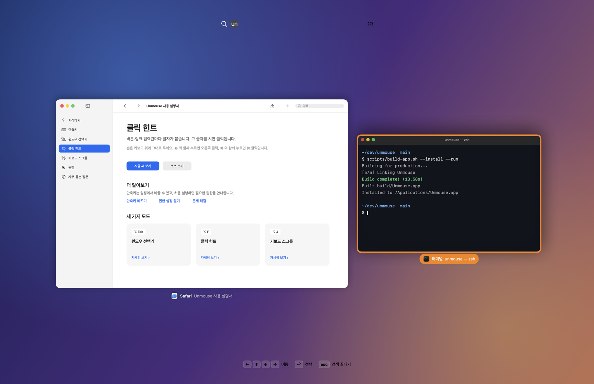
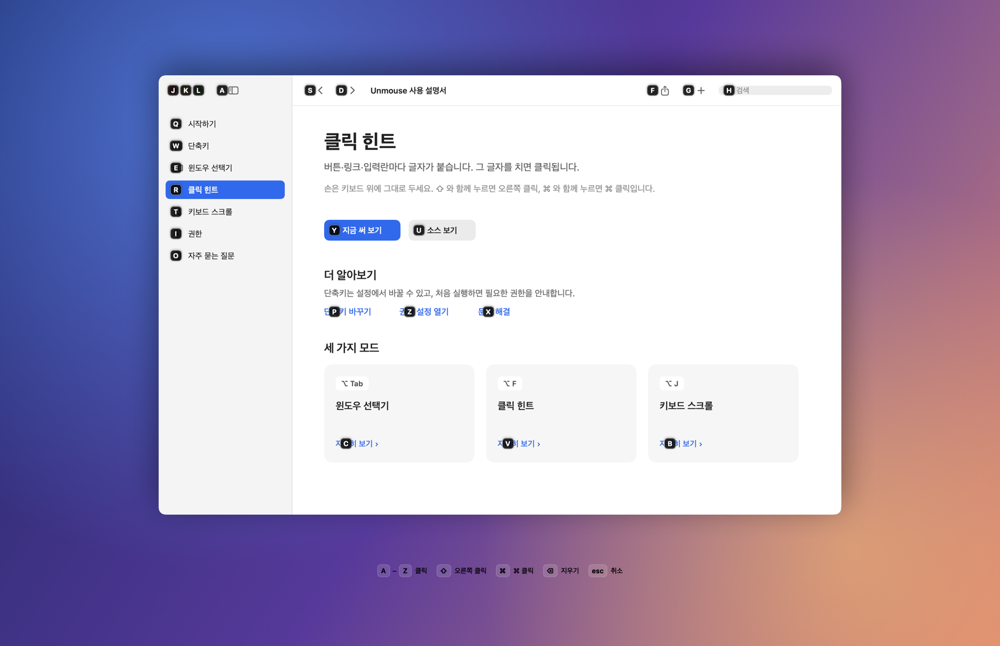
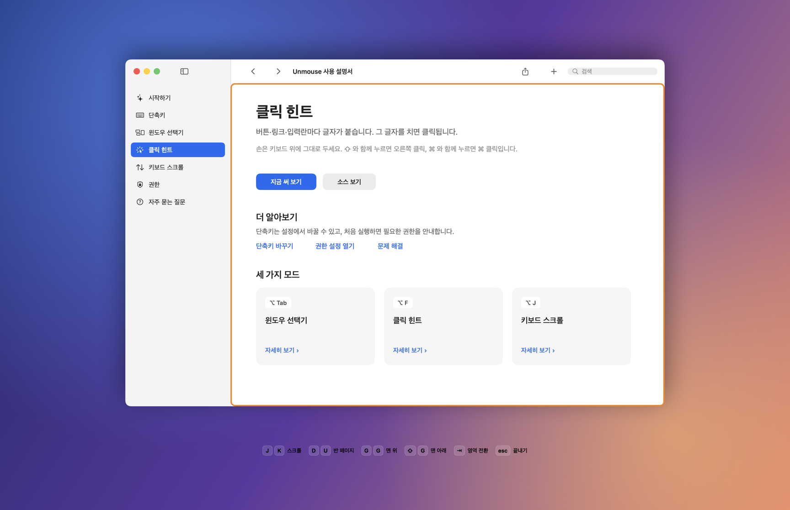

# Unmouse

마우스 없이 키보드만으로 macOS를 쓰게 해 주는 메뉴 막대 앱입니다.
윈도우 전환, 클릭, 스크롤 — 손이 마우스로 가던 세 가지 순간을 단축키 하나씩으로 바꿉니다.

| 기능 | 기본 단축키 | 하는 일 |
| --- | --- | --- |
| 윈도우 선택기 | `⌥Tab` | 열린 윈도우를 한 화면에 펼치고 글자 하나로 바로 이동 |
| 클릭 힌트 | `⌥F` | 버튼·링크·입력란에 글자를 붙이고, 그 글자를 치면 클릭 |
| 키보드 스크롤 | `⌥J` | `J` `K` `D` `U` 로 지금 보는 영역을 스크롤 |

세 단축키는 모두 설정에서 바꿀 수 있습니다.



## 윈도우 선택기 — `⌥Tab`

모든 데스크탑의 윈도우를 미리보기로 펼쳐 보여 줍니다. 각 미리보기에 붙은 글자를 누르면 그 윈도우로 바로 이동합니다.

위 화면에서 `S` 를 누르면 터미널로, `F` 를 누르면 다른 데스크탑에 있는 캘린더로 바로 이동합니다. 최소화된 윈도우도 함께 보입니다.

`/` 를 누르고 입력하면 앱 이름·윈도우 제목으로 걸러집니다.



| 키 | 동작 |
| --- | --- |
| `⌥Tab` | 열기 · 열린 상태에서는 다음 윈도우 |
| `A` … `Z` | 미리보기에 표시된 글자의 윈도우로 바로 이동 |
| `←` `↑` `↓` `→` | 선택 이동 (`Tab` / `⇧Tab` 도 가능) |
| `Space` | 선택한 윈도우로 이동 (`↩` 도 가능) |
| `/` | 앱 이름·윈도우 제목 검색 (검색 중에는 `↩` 로 선택) |
| `⌘,` | 설정 열기 |
| `esc` | 닫기 |

## 클릭 힌트 — `⌥F`

지금 쓰는 윈도우의 버튼·링크·입력란마다 글자를 표시합니다. 그 글자를 입력하면 해당 위치를 클릭합니다.



위 화면에서 `Y` 를 누르면 "지금 써 보기" 버튼을, `T` 를 누르면 사이드바의 "키보드 스크롤" 항목을 클릭합니다.

| 키 | 동작 |
| --- | --- |
| `⌥F` | 힌트 표시 |
| `A` … `Z` | 표시된 글자를 입력하면 그 자리를 클릭 |
| `⇧` + 마지막 글자 | 오른쪽 클릭 |
| `⌘` + 마지막 글자 | `⌘` 클릭 (새 탭으로 열기 등) |
| `⌫` | 한 글자 지우기 |
| `esc` | 취소 |

Chrome 등 일부 앱은 처음 한 번은 웹 페이지 요소가 덜 보일 수 있습니다. 그럴 때는 단축키를 한 번 더 누르세요.

## 키보드 스크롤 — `⌥J`

스크롤 모드를 켜면 스크롤할 영역 가운데로 포인터가 이동하고, 아래 키로 스크롤합니다.



테두리가 지금 스크롤되는 영역입니다. `Tab` 을 누르면 사이드바로 넘어갑니다.

| 키 | 동작 |
| --- | --- |
| `⌥J` | 스크롤 모드 켜기 / 끄기 |
| `J` `K` | 아래 / 위로 스크롤 (`↓` `↑` 도 가능, 누르고 있으면 계속) |
| `D` `U` | 반 페이지 아래 / 위 (`Space` 는 한 페이지 아래) |
| `G` `G` | 맨 위로 |
| `⇧G` | 맨 아래로 |
| `H` `L` | 왼쪽 / 오른쪽으로 스크롤 |
| `Tab` | 스크롤할 영역 바꾸기 (사이드바 ↔ 본문 등) |
| `esc` | 끝내기 |

## 설정


설정 창은 메뉴 막대 아이콘의 **설정…** 으로 열거나, 이미 실행 중일 때 Spotlight에서 Unmouse를 다시 실행하면 열립니다. 설정 창 안에서도 마우스가 필요 없습니다.

- `⌘R` / `⌘E` / `⌘D` 를 누른 뒤 새 단축키를 입력하면 윈도우 선택기 / 클릭 힌트 / 키보드 스크롤 단축키가 바뀝니다.
- `⌘1` / `⌘2` 로 각 권한의 시스템 설정 화면을 엽니다.
- 로그인 시 자동 실행, 다른 데스크탑의 윈도우 포함, 최소화되거나 가려진 윈도우 포함 여부를 켜고 끌 수 있습니다.

## 권한

처음 실행하면 설정 창이 열리고 두 가지 권한을 안내합니다.

| 권한 | 쓰는 곳 | 없으면 |
| --- | --- | --- |
| 손쉬운 사용 | 클릭 힌트, 키보드 스크롤, 다른 데스크탑·최소화된 윈도우와 윈도우 제목 | 클릭 힌트와 스크롤을 쓸 수 없고, 선택기에는 현재 화면의 윈도우만 표시 |
| 화면 및 시스템 오디오 녹화 | 윈도우 미리보기 이미지 | 미리보기 대신 앱 아이콘으로 표시 |

화면 기록 권한은 허용한 뒤 Unmouse를 다시 실행해야 적용됩니다. 화면 내용은 이 Mac 밖으로 전송되지 않습니다.

## 설치

macOS 26 이상과 Swift 6 툴체인(Xcode 26)이 필요합니다.

```sh
git clone https://github.com/olennis/unmouse.git
cd unmouse
scripts/build-app.sh --install --run
```

- 인자 없이 실행하면 `build/Unmouse.app` 만 만듭니다.
- `--install` 은 `/Applications/Unmouse.app` 으로 복사하고, `--run` 은 빌드한 앱을 실행합니다.
- 코드 서명 인증서(Apple Development 또는 Developer ID)가 있으면 그것으로 서명해서 다시 빌드해도 권한이 유지됩니다. 없으면 ad-hoc 서명이라 빌드할 때마다 권한을 다시 허용해야 합니다. `CODESIGN_IDENTITY` 환경 변수로 인증서를 지정할 수 있습니다.

## 알아 둘 점

- 다른 데스크탑의 윈도우를 앞으로 가져오기 위해 비공개 프레임워크(SkyLight)를 사용합니다. macOS 업데이트에 따라 동작이 달라질 수 있고, Mac App Store 배포는 불가능합니다.
- 윈도우 선택기, 클릭 힌트, 키보드 스크롤은 한 번에 하나만 켜집니다.

## 예시 화면 다시 만들기

이 문서의 예시 화면은 실제 화면 캡처가 아니라, 가상의 윈도우 위에 앱의 실제 UI 를 렌더링한 것입니다. 권한 없이 다시 만들 수 있습니다.

```sh
swift build -c release
.build/release/Unmouse --demo docs/images     # 선택기·검색·클릭 힌트·스크롤
```
